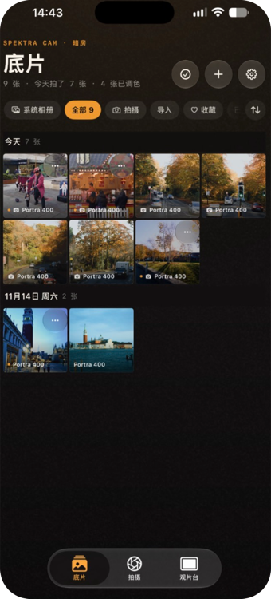
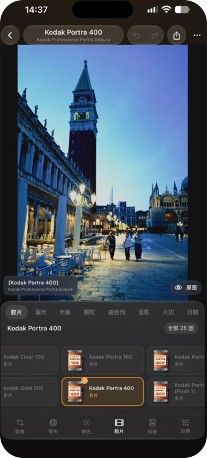
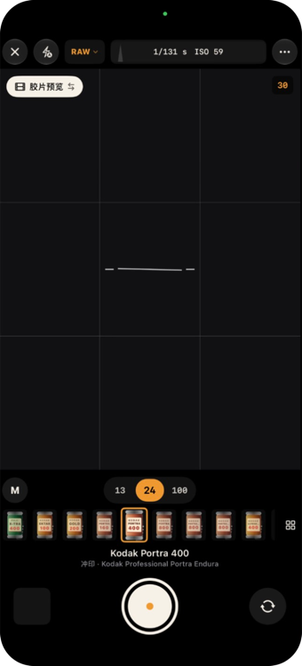
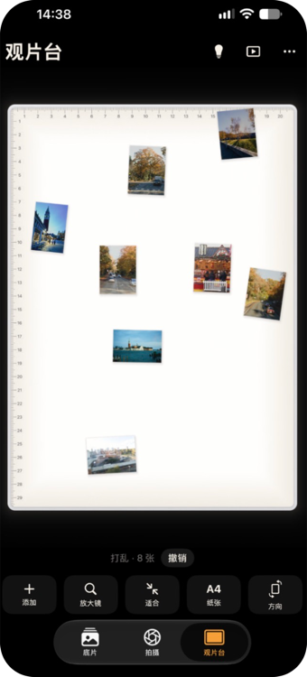
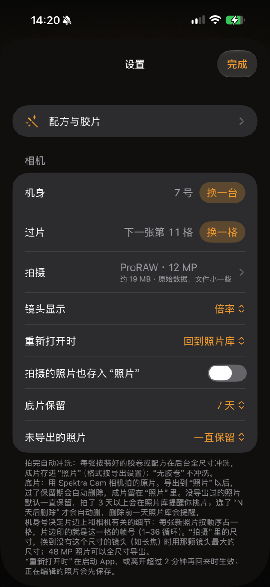
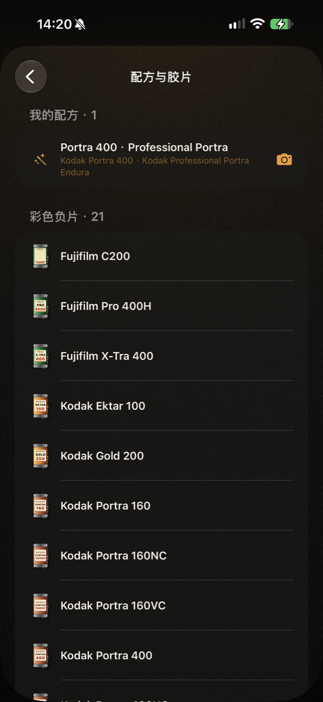

# Spektra Cam · an unofficial iOS port of SpektraLab

[中文](README.md) | **English**

**Spektra Cam is an unofficial iPhone port of [SpektraLab](https://github.com/JamesQiu2005/SpektraLab), the Mac film-developing app.** It uses the same physical film engine — film exposure, dye layers, grain, halation, the enlarger and the paper, computed all the way through rather than a LUT laid over the photo — and adds a camera, a light table and more on the iPhone.

> Unofficial: this is not an app published by the author of SpektraLab.
> The film engine comes from [JamesQiu2005/SpektraLab](https://github.com/JamesQiu2005/SpektraLab) (this version uses engine 2.4.1);
> the starting point was its iOS community port [Minerchu/SpektraLab-iOS](https://github.com/Minerchu/SpektraLab-iOS) 1.2.0, since redesigned and greatly extended.

## Screenshots

| Negatives | Editor | Camera |
|:---:|:---:|:---:|
|  |  |  |
| **Light Table** | **Settings** | **Recipes and Films** |
|  |  |  |

Screenshots of 2.1.7 on an iPhone 17 Pro Max (taken 2026-11-27, Chinese interface). The app is in Chinese and English and follows your iPhone's language.

## Download and install

### Recommended: add the source (SideStore / AltStore)

In SideStore or AltStore, open Sources, tap ＋ and paste the address below, then install Spektra Cam from the source. When a new version comes out, just tap Update in the app — no IPA to download.

```
https://raw.githubusercontent.com/HLyu3/SpektraCam/main/source.json
```

### Or: download the IPA

Download `SpektraCam-2.1.7-unsigned.ipa` from **[Releases](../../releases/latest)**. The IPA is not signed; sign it with your own Apple ID:

| Tool | How |
|---|---|
| SideStore / AltStore / Sideloadly | Choose the IPA and sign it with your own Apple ID |
| Xcode | Build it as in “Building locally” below and pick your Personal Team under Signing |

- Requires **iOS 18.0** (iPhone XS / XR and later), iPhone only. Before iOS 26 the interface uses a frosted material instead of Liquid Glass.
- **Tested on iPhone 17 Pro Max and iPhone 14 Pro.** Any iPhone on iOS 18 or later can install it; other models are untested, and lens focal lengths, capture sizes, export sizes and HDR brightness may be off.
- A free Apple ID's signature expires after 7 days; reinstall then.
- The IPA carries all engine resources; the first launch needs no download.
- Language: the app follows your iPhone's language (Chinese or English). To change it for this app only, go to Settings › Spektra Cam › Language.

## What's new in 2.1.7 (since 2.1.6)

- **Chinese and English**: the whole app, including the share sheet's messages, follows your iPhone's language.

## What's new in 2.1.6 (since 2.1.5)

- **Front camera**: uses the iPhone 17's square front sensor (as the Camera app does) with ProRAW; portrait or landscape without turning the phone, 0.6× and 1× framings; upright, mirrored shots; no more squashed viewfinder; the framing turn blurs across instead of ghosting.
- **Film-edge photos export again**: photos with the film edge on (cine gauges included) failed to export.
- **Slides are scanned**: Ektachrome, Kodachrome, Provia and Velvia are no longer printed on paper, as in the Mac app.
- **Films and papers by type**: colour negative / slide / cine negative / B&W negative; switch back to by-brand at the top left of the All page.
- Picking a cine gauge turns the film edge on; the camera's paper button follows the loaded roll; Verita 200D has a recommended paper; the selection bar is one row of equal buttons.

## What's new in 2.1.5 (since 2.1.4)

- **Matches the Mac app**: RAW decoding as the Mac app does it (iPhone RAW shadows no longer crushed); camera shots meter “Protect highlights”, imports “Balanced” as on the Mac; “Auto placement” no longer errors when turned on.
- **Camera**: ProRAW 12 MP by default; shots develop in the background in the app with progress on the wall, no longer saved to Photos automatically and never blocking you; developed photos open instantly in the viewer and editor.
- **Faster**: the editor opens in about 0.45 s instead of about 2 s; leaving the editor without changes no longer re-develops. The develop cache shows its size in Settings › Develop and is cleared after 14 days unviewed by default.
- **Navigation**: no tab bar; Negatives is home — the shutter button at the bottom raises the camera, the button at the top right pushes in the light table; switching back and forth quickly no longer freezes.
- **Negatives**: tiles fill the screen width and are larger; the tiles' ⋯ is gone (the long-press menu has it all); pasting a recipe keeps a shot's own exposure compensation.

## What's new in 2.1.4 (since 2.1.3)

- **Negatives**: a tap opens the viewer first (swipe, zoom, hold for the original; “Edit” opens the editor); compare two photos; batch export (it says which were exported before); recommended export settings.
- **Camera**: opens faster with an aperture opening; 44 pt buttons, tighter on narrow phones; steadier tap to focus.
- **Light Table**: 3072 px sharp versions; the loupe draws a top-down loupe at your finger, hold for an 8× full-screen lens; long-presses no longer trigger it while it is off.

## What's new in 2.1.3 (since 2.1.2)

- Runs on iOS 18 and later.
- Fixes 2.1.1 / 2.1.2 shipping stale engine resources: Portra 160 / 400 NC and VC no longer print too cyan.
- Shoots RAW by default (ProRAW on Pro models, single-frame RAW on others); the format page spells out HEIF's drawbacks and warns when HEIF is used with a film.
- Auto-develop after shooting is off by default.

## What's new in 2.1.2 (since 2.1.1)

**Camera**
- Tap to focus: focus and exposure follow the point you tap; smoother lens moves. The focus box lands, dims and fades as in the Camera app.
- New installs default to HEIF 48 MP; the roll shelf comes with a “Portra 400 · Professional Portra” combination.

**Editor**
- **White-balance eyedropper** (Exposure › White balance): tap something grey or white to correct a cast before the film is exposed; works on any format.
- **Film comparison grid** (Film › Compare): this photo developed small on every film; tap one to use it.

## What's new in 2.1.1 (since 2.1.0)

**Engine upgraded to SpektraLab 2.4.1**
- New films: Portra 160 NC / 160 VC / 400 NC / 400 VC (VC prints on Portra Endura by default).
- Light leaks gain “Edge burn”, with a random position or back to the camera body's position.
- The film edge gains cine gauges: Super 8, Super 16, 35 mm 4-perf, 65 mm 5 / 15-perf, and 135 exposed across the sprockets.
- Films and papers listed by brand.

**Editor**
- The crop page works like Photos: the box stays still, drag and pinch the photo; new rotate left 90° and flip horizontal.
- Colour balance becomes four colour wheels (global, shadows, midtones, highlights).
- New **channel mixer** and **watermarks** (a PNG logo or text in any corner, with size, margin, opacity, rotation and colour; carried by exports, thumbnails and the light table).
- The editor's ⋯ menu can show a histogram.

**Camera and negatives**
- The capture format is an explained page: HEIF (everyday), ProRAW (when it matters), RAW (single frame, only in good light), each with its use and file size.
- After copying a recipe, long-press any photo to paste or clear it; the source photo is no longer locked.

## What's new in 2.1.0 (since 2.0.0)

**Camera**
- **Paper follows the roll**: a roll prints on its recommended paper (Portra 400 → Portra Endura, cine film → 2383); change it with the “Paper” button under the roll name, and the recommended paper you pick is remembered. The editor follows the same rule, so later developing matches.
- **Favourite combinations**: ☆ next to the roll name saves “film + paper” as a combination at the front of the roll shelf.
- **Exposure as in the Camera app**: tap to focus, drag up and down to set exposure (the sun slider), long-press to lock focus and exposure (AE/AF Lock).
- Single-frame RAW is shot 1 stop under to keep highlights; the film's metering brings it back when developing.
- The Camera Control and the volume buttons act as the shutter on the camera page.
- Focal-length buttons show zoom factors (0.5 · 1× · 2 · 4 · 8) or focal lengths; they turn upright when the phone is held sideways; the paper shows under the roll.
- Shots taken with “No film” go only to the system photo library, not to Negatives.

**Import and RAW**
- **RAW from every maker**: when the system can't read a RAW, gives only its small embedded preview or decodes it black, LibRaw takes over; old bodies without an as-shot white balance (e.g. Mamiya ZD) use the camera's daylight balance. Tested with samples in 22 formats: Canon CR3 / CR2 / CRW, Nikon NEF (incl. Z 8 high-efficiency), Sony ARW, Fujifilm RAF, Panasonic RW2, Olympus ORF, Pentax PEF, Leica DNG / RWL, Hasselblad 3FR, Phase One IIQ, Leaf MOS, Mamiya MEF, Samsung SRW, Kodak DCR, Minolta MRW, Epson ERF, DJI and iPhone DNG.
- **Spektra Cam in Photos' share menu**: share photos to it and they are imported the next time the app opens (RAW + JPEG keeps the RAW).
- Imported photos start as “No film” (the original); choose a film when you want to develop.
- “Imported before” only counts photos still in Negatives: delete one and it can be imported again; when everything was imported before you can choose “Import Again”.
- Import failures list each file and why; RAW thumbnails are made one by one after the import.
- Settings shows and changes photo access (also when only some photos were allowed).

**Editor**
- **Preview in Display P3**: the editor, thumbnails, slides and exported prints match (the preview used to be sRGB and greyer than the print).
- **No film**: the first item under Film shows the original (RAW with the system's or LibRaw's default decode); finishing and crop still work.
- **Slide HDR**: slides get a per-pixel gain from two engine renders; brighter on HDR screens, and JPEG / HEIF exports carry a gain map.

**Negatives**
- Select by **sliding sideways** as in Photos, auto-scrolling at the edges; Select All / Deselect All.
- Cull is a button of its own; date headers are floating capsules.

**Light Table**
- Photos are laid out at their negative's real size by default, or at 5-inch print size; pinch a selected photo to resize it alone, one tap back to its size.
- Stacked photos cover each other; the bottom bar has the film tray, lamp and loupe — tap from the tray or drag onto the table.
- Long-press for an immersive big lens (clear of your finger, the rest darkened); a 2048 px sharp version is developed when you zoom; slides can be pinched.

## 2.0.0: changes from the community port 1.2.0

**Interface: the darkroom**
- New name, new icon; a new palette (graphite, paper white, safelight amber) and a film-grain background.
- Three places: **Negatives** (library) · **Camera** · **Light Table**.

**Negatives (library)**
- One-tap filters (shot / imported / favourites / graded / RAW / pairs / film), sorted by date taken, date added or film.
- Grouped by day; pinch like Photos for 1–14 photos a row, grouped by month when zoomed out.
- Develops straight from the system library (no copy) or imports into the app; imports from Files, a card reader (a whole DCIM folder) and other apps; RAW + JPEG keeps the RAW; anything imported before is skipped.
- Cull: unexported shots by day — export the keepers, delete the rest; how long negatives are kept is configurable.
- Recipe library: save recipes, favourite films, apply to many photos at once.

**Editor**
- Tools in the order light travels: Frame · Lens · Exposure · Film · Paper · Finish.
- Crop and straighten, global undo / redo, long-press for the original.
- Decode curve, black-and-white films (Tri-X, T-Max 100, Acros II, HP5 on Multigrade paper grades 00–5), anti-halation removal, light leaks, diffusion filters, lens character (swirl, Petzval, vintage, toy).
- Finish (Layer 2): light, colour, HSL, curves, colour balance.
- **HDR**: the engine works out a per-pixel gain from the film and paper's shoulder; the editor goes brighter than white on HDR screens, and JPEG / HEIF exports carry an ISO gain map.
- Half-frame pairs: two photos joined as one half-frame negative.
- Export: JPEG / 10-bit HEIF / 16-bit TIFF / PNG in sRGB / Display P3 / Adobe RGB / ProPhoto, size capped by memory; 48 MP exports at full size.

**Camera**
- ProRAW, single-frame RAW (no multi-frame merging or noise reduction), HEIF; each lens's real sizes.
- Focal lengths 13 / 24 / 48 / 100 / 200 mm (48 and 200 are in-sensor crops), pinch to zoom.
- The viewfinder shows the film's colour live (a 3D LUT baked by the engine); manual shutter, ISO, exposure compensation, colour temperature; level, grid, histogram.
- A roll can be a film, a recipe or “No film” (the original straight to Photos); shots can develop in the background.

**Light Table**
- Photos laid out at their real millimetre size on an A4 / A5 / A6 light box — drag, rotate, tidy, shuffle.
- EDR backlight, lamp on/off, loupe (2–8×, hold still to lean in), full-screen slideshow.

The project, targets and code keep the name `SpektraLab` (`ios/SpektraLab.xcodeproj`); only the app shows as Spektra Cam.

## Building locally

Needs an Apple silicon Mac, Xcode 27.2+, the iOS 27 SDK and Python 3.10+.

```bash
git clone https://github.com/HLyu3/SpektraCam.git
cd SpektraCam

# Engine: upstream 2.4.1
GITHUB_TOKEN="<your GitHub token>" python3 tools/fetch-engine.py \
  JamesQiu2005/SpektraLab f61769b6779632497cb9c457945326c8de45436e .
# 2.4.x dropped the film cover images: take engine/resources_product/film_covers from the previous engine
GITHUB_TOKEN="<your GitHub token>" python3 tools/fetch-engine.py \
  JamesQiu2005/SpektraLab 02d82b56cf65f0f8e802a708612edc4e9a4790af /tmp/engine-1.3.5
cp -R /tmp/engine-1.3.5/engine/resources_product/film_covers engine/resources_product/
python3 tools/apply-ios-patch.py engine      # run once, on a freshly fetched engine only

bash engine/setup-libraw.sh                  # LibRaw 0.22.2
ios/Tools/build-engine.sh bundle device      # must run before generating the project

SPEKTRAFILM_BUNDLE_ID=<your bundle id> SPEKTRAFILM_SIGNING_STYLE=Automatic \
SPEKTRAFILM_SIGN_IDENTITY="Apple Development" SPEKTRAFILM_TEAM_ID=<your Team ID> \
  python3 ios/Tools/gen-project.py
open ios/SpektraLab.xcodeproj
```

Run `ios/Tools/build-engine.sh bundle device` before `gen-project.py`, or the project lacks `engine-assets.bin` and the app shows “The engine is still getting ready” forever.

For “launch from the Camera Control” (press the Camera Control on the Lock Screen → unlock → the camera page), add `SPEKTRAFILM_CAMERA_CONTROL=1` when generating the project; it builds two more extensions and can only be installed with Xcode's own signing.

A free account can use `com.apple.developer.kernel.increased-memory-limit` (already in the entitlements); 48 MP full-size exports need it.

## Known limitations

- Tested on iPhone 17 Pro Max and iPhone 14 Pro only (see “Download and install”).
- iPhone only; no iPad layout.
- No video.
- HDR gain maps are at most 2048 px.
- Sigma Foveon (X3F) and GoPro GPR RAW are not supported (the app's LibRaw can't read them); import says so.
- Photos shared from the share menu are imported when the app is next opened (a share extension can't open its app).
- No launching from the Camera Control (it needs a Lock Screen extension that tools like SideStore can't sign; the code is kept for later).
- Re-signing with a free Apple ID uses 2 App IDs (the app and the share extension) and an App Group.
- `.github/workflows/build-ios.yml` is the community port's CI kept as it was: pinned to the old engine and needing the community port's signing secrets, it can't build this version; Actions don't run on forks by default — please don't enable it. This version's IPA is built locally.

## License and credits

Spektra Cam stands on these open-source projects:

| Project | Used for | License |
|---|---|---|
| [SpektraLab](https://github.com/JamesQiu2005/SpektraLab) (JamesQiu2005) | The film-developing engine (C++ / Metal), black-and-white film and Multigrade paper profiles, parts of the light table and HDR code | GPL-3.0-or-later |
| [spektrafilm](https://github.com/andreavolpato/spektrafilm) (Andrea Volpato) | The film process model the SpektraLab engine follows; 28 measured film and paper profiles, enlarger LUTs | Model GPL-3.0-or-later; profiles and LUTs CC BY-SA 4.0 |
| [SpektraLab-iOS](https://github.com/Minerchu/SpektraLab-iOS) (Minerchu) | Starting point: the iOS community port 1.2.0 | GPL-3.0-or-later |
| [LibRaw](https://github.com/LibRaw/LibRaw) 0.22.2 | Fallback decoding for RAWs Core Image can't read | LGPL-2.1 / CDDL-1.0 |
| [metal-cpp](https://developer.apple.com/metal/cpp/) (Apple) | The engine's C++ interface to Metal | Apache-2.0 |

Spektra Cam's code is distributed under **GPL-3.0-or-later** (see `LICENSE`); the film and paper profiles under **CC BY-SA 4.0**.

## Trademarks

SpektraLab™ and its icon belong to their owners. Spektra Cam is an independent, unofficial project, not affiliated with or endorsed by SpektraLab or the spektrafilm project; it has its own name and icon and only says “based on the SpektraLab engine”. Film and paper names are their makers' trademarks, used only to say which public data a profile is based on.
