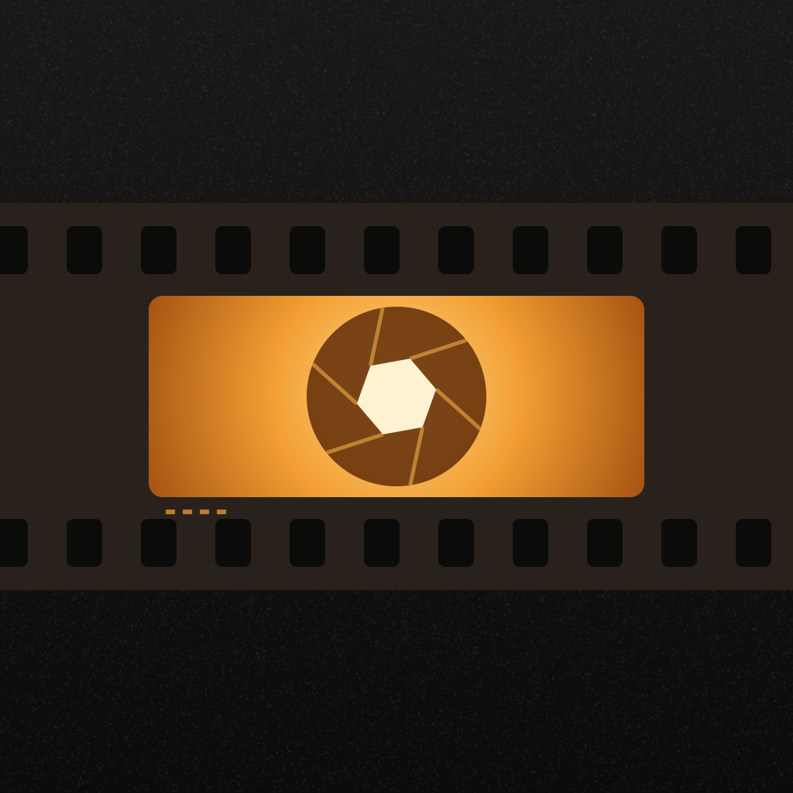
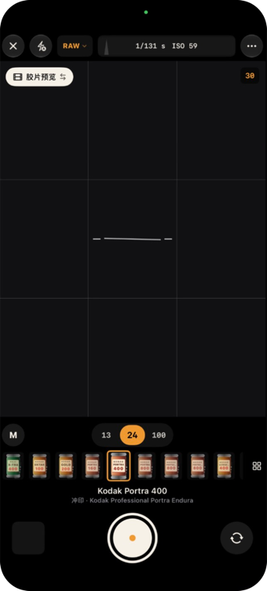
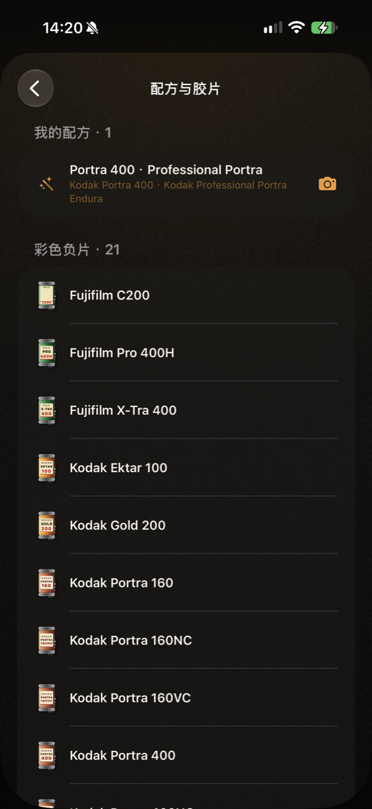

<p align="center"></p>

<h1 align="center">Spektra Cam</h1>

<p align="center">在 iPhone 上拍照，用 SpektraLab 的胶片物理引擎冲洗。</p>

<p align="center"><b>简体中文</b> · <a href="README.en.md">English</a></p>

<p align="center"><b>当前版本：</b>2.1.7（Build 15） · <b>系统要求：</b>iOS 18+</p>

<p align="center">    </p>

<p align="center"><a href="../../releases/latest">下载最新版</a> · <a href="#安装步骤">安装教程</a> · <a href="#5-添加-spektra-cam-软件源">软件源</a> · <a href="#从源码编译">从源码编译</a></p>

**Spektra Cam 是 [SpektraLab](https://github.com/JamesQiu2005/SpektraLab)（Mac 上的胶片冲洗软件）的非官方 iPhone 移植版。** 用的是同一个胶片物理引擎——胶片曝光、染料层、颗粒、光晕、放大机与相纸，一路算下来，而不是给照片套一张 LUT——并在 iPhone 上加了相机、观片台等功能。起点是它的 iOS 社区移植版 [Minerchu/SpektraLab-iOS](https://github.com/Minerchu/SpektraLab-iOS) 1.2.0，之后界面重做、功能大幅扩展。项目保留原作者署名和上游链接，不代表 SpektraLab 官方。

如果这个项目帮到了你，欢迎点一个 **Star**；发现问题或有改进建议，欢迎提交 [Issue](../../issues)。

## 当前进展

- 当前版本 **2.1.7（Build 15）**，以 GitHub Release 中的未签名 IPA 分发，用 SideStore 等自签方式安装；也可以添加[软件源](#5-添加-spektra-cam-软件源)，以后在 SideStore 里直接更新。
- 胶片引擎是上游 SpektraLab **2.4.1**，同一张 RAW 在 Mac 版和 Spektra Cam 里冲出来的颜色一致（逐张对比过）。
- 已完成：相机（ProRAW / 单帧 RAW / HEIF、iPhone 17 方形前置）、按光路排的暗房编辑、30 款胶片与 7 种相纸、片边与电影画幅、HDR、观片台、配方库、批量导出，中英双语界面。
- 已在 iPhone 17 Pro Max（iOS 27）和 iPhone 14 Pro（iOS 26.5）上实测；其他机型能装，但镜头焦段、拍摄尺寸、导出大小和 HDR 亮度没有验证过。
- 每个版本更新了什么，见 [Releases](../../releases)。

## 界面预览

| 底片 | 编辑 | 拍摄 |
|:---:|:---:|:---:|
|  |  |  |
| **观片台** | **设置** | **配方与胶片** |
|  |  |  |

截图是 2.1.7 在 iPhone 17 Pro Max 上的界面（2026-11-27 截）。

## 主要功能

- **拍摄**：ProRAW、单帧 RAW（不做多帧合成与降噪）、HEIF；按镜头列出焦段（iPhone 17 Pro Max 上是 13 / 24 / 48 / 100 / 200 mm）；取景器实时显示胶片色彩；手动快门、ISO、曝光补偿、色温；点按对焦、上下拖动调曝光、长按锁定；水平仪、网格、直方图；相机控制键和音量键当快门。
- **前置相机**：iPhone 17 的方形前置传感器，不转手机也能竖拍或横拍，0.6× 和 1× 两档，支持 ProRAW。
- **胶卷**：装一卷胶片、一个配方，或「无胶卷」（原始文件直接进「照片」）；相纸跟着胶卷走，推荐相纸会记住；拍完在后台冲洗，不挡操作。
- **编辑**：按光路排的工具——取景 · 镜头 · 曝光 · 胶片 · 相纸 · 后期；裁剪、拉直、旋转、翻转；白平衡吸管；解码曲线；全局撤销 / 重做；按住看原图。
- **胶片与相纸**：30 款胶片（彩色负片、反转片、电影负片、黑白负片）和 7 种相纸，按类型或品牌排列；黑白胶片配 Multigrade 相纸 00–5 号；反转片直接扫描；胶片对比网格一次看完所有胶片。
- **效果**：片边、齿孔与日期后背，电影画幅（Super 8 / 16、35 mm、65 mm、IMAX）；漏光与边缘烧灼、柔光镜、镜头风格（漩涡、Petzval、老镜头、玩具镜头）、去防光晕层。
- **后期**：光线、色彩、HSL、曲线、四个色轮的色彩平衡、通道混合、水印；**HDR**：在 HDR 屏幕上亮过白色，导出附增益图。
- **底片（图库）**：直接读系统相册（不复制）或导入 App；支持各家相机的 RAW（含 LibRaw 回退）、存储卡整个 DCIM 文件夹、从「照片」分享过来；按天分组、双指缩放、筛选与排序；横向滑动多选、复制粘贴配方、半格双拼、两张对比；挑片和批量导出。
- **观片台**：照片按底片的真实毫米尺寸摆在灯箱上；EDR 背光、开关灯、放大镜（按住凑近 8×）、全屏幻灯。
- **导出**：JPEG / 10 位 HEIF / 16 位 TIFF / PNG，sRGB / Display P3 / Adobe RGB / ProPhoto，三组推荐设置；按内存自动限制尺寸，4800 万像素可全尺寸导出（开片边时约 3100 万）。

## 实现原理

Spektra Cam 不是滤镜 App。每张照片都交给 SpektraLab 引擎（C++ / Metal，跑在 iPhone 的 GPU 上）从头冲洗一遍：

1. **解码**：RAW 用 Core Image 解成场景线性的 ProPhoto 数据，解码参数和 Mac 版完全一样；Core Image 读不了的 RAW 改用 LibRaw。
2. **胶片曝光**：按胶片的光谱感光度把场景光换成三层乳剂的曝光，再按特性曲线显影出染料密度；颗粒、光晕、成色剂的层间抑制都在这一步按物理尺寸（微米）算。
3. **印放**：放大机的光穿过底片照到相纸上，相纸再显影一次，得到最终的颜色和影调；反转片跳过这一步，直接扫描。
4. **后期**：亮度、色彩、曲线等调整（Layer 2）在冲洗好的成片上用 GPU 再算一遍，调这些不用重新冲洗。

胶片和相纸的特性数据来自 [spektrafilm](https://github.com/andreavolpato/spektrafilm) 的实测描述档。

## 与 Mac 版 SpektraLab 的区别

| | Spektra Cam | SpektraLab（Mac） |
|---|---|---|
| 设备 | iPhone | Mac |
| 冲洗引擎 | 同一个引擎（2.4.1），颜色一致 | 原版 |
| 拍摄 | 内置胶片相机，取景器实时显示胶片色彩 | 只冲洗已有照片 |
| 观片台 | 有，带 EDR 背光和放大镜 | 有 |
| 片边全尺寸导出 | 受手机内存限制，约 3100 万像素 | 全尺寸 |
| 发布方式 | 非官方，GitHub 发布，需要自签安装 | 官方 |

### 怎么选

- 用 iPhone 拍照、想直接出胶片效果的，用 Spektra Cam。
- 在电脑上批量处理大量照片、要全尺寸片边成片的，用 Mac 版。
- 两边冲洗结果一致，可以在 iPhone 上先拍先看，回到电脑再精修。

## 优点与已知限制

Spektra Cam 的主要优点：

- 和 Mac 版同一个物理引擎，不是 LUT，换胶片、换相纸、调曝光的反应和真胶片一致。
- 相机、编辑、观片台都在手机上完成，不需要电脑。
- 照片、配方和缩略图都留在 iPhone 本地，不联网、不上传。
- 可以直接冲洗系统相册里的照片，不复制原图，不改动原图。

当前限制：

- 最低系统 iOS 18.0，只支持 iPhone，没有 iPad 布局。iOS 26 以前的界面用磨砂背景代替玻璃质感。
- 没有视频。
- 开着片边时导出最大约 3100 万像素（引擎还不支持分块渲染片边，整张一次渲染受手机内存限制）。
- HDR 增益图最长 2048 px。
- 不支持 Sigma Foveon（X3F）和 GoPro GPR 两种 RAW，导入时会提示。
- 从分享菜单传来的照片要等打开 App 时才导入（分享扩展不能直接打开 App）。
- 不能用相机控制键在锁屏直接启动（需要一个 SideStore 签不了的锁屏扩展；代码保留，以后再上）。
- SideStore 免费签名受 Apple 的七天刷新、App 数量和 App ID 数量限制；Spektra Cam 占 2 个 App ID（主程序 + 分享扩展）。

## 安装前准备

下面是免费路线：**iLoader + SideStore（正式版）+ LocalDevVPN + Spektra Cam**。

你需要：

- 一台运行 iOS 18 或更高版本的 iPhone，并已设置锁屏密码。
- 一台 Mac、Windows 或 Linux 电脑，只在第一次安装 SideStore 时用。
- 一根可以传输数据的 USB 线。
- 一个 Apple 账号，免费账号即可。
- Wi-Fi。SideStore 安装或刷新 App 时需要同时连接 Wi-Fi 和 LocalDevVPN。

各工具请从官方入口下载：

| 工具 | 安装位置 | 入口 |
|---|---|---|
| iLoader | 电脑 | [iloader.app](https://iloader.app) |
| SideStore | iPhone，由 iLoader 安装 | [SideStore 安装文档](https://docs.sidestore.io)（请阅读英文版） |
| LocalDevVPN | iPhone | App Store |
| Spektra Cam | iPhone，由 SideStore 安装 | 本仓库的软件源或 [Releases](../../releases/latest) |

Spektra Cam 暂未通过 App Store 或 TestFlight 分发。不要使用来源不明的网盘或镜像，安装包可能被重新打包。

## 安装步骤

### 1. 在 iPhone 上安装 LocalDevVPN

1. 从 App Store 安装 LocalDevVPN。国区商店搜不到，请使用美区等其他地区的账号。
2. 打开后轻点 **Connect**，允许它添加 VPN 配置，并输入锁屏密码。
3. 确认它显示已连接。

名称里虽然有 VPN，但它不会改变公网 IP，也不能代理上网，只是让 SideStore 访问 iPhone 本机的服务。开启它会断开手机上正在运行的其他代理或 VPN；装完、刷新完 App 后可以关掉。

### 2. 用 iLoader 安装 SideStore

1. 在电脑上安装 iLoader。
2. 用数据线连接并解锁 iPhone；如果出现「要信任此电脑吗」，选择「信任」并输入锁屏密码。
3. 打开 iLoader，确认设备列表里出现了这台 iPhone。找不到时先换一根数据线，再确认 Finder、iTunes 或 Apple Devices 能看到这台 iPhone。
4. 在 iLoader 中登录 Apple 账号，按提示输入双重认证验证码。
5. 选择这台 iPhone，点击 **Install SideStore (Stable)**——用正式版，不用其他版本。
6. 等待签名和安装完成，中途不要拔线。

如果 iLoader 询问是否撤销已有证书，先确认这个 Apple 账号有没有给其他侧载工具使用；撤销证书可能让此前用它签名的 App 失效。

### 3. 信任开发者并开启开发者模式

1. 打开「设置 → 通用 → VPN 与设备管理」，在「开发者 App」下选择你的 Apple 账号，轻点「信任」。
2. 打开「设置 → 隐私与安全性 → 开发者模式」并开启。
3. 按提示重启 iPhone，重启并解锁后再次确认开启。

开启开发者模式不需要付费加入 Apple Developer Program。用 SideStore 装的 App 都需要它。如果 Apple 提示账号没有可用的开发团队，登录 [developer.apple.com/register](https://developer.apple.com/register) 接受协议即可，这一步免费。

### 4. 第一次刷新 SideStore

1. 连接 Wi-Fi，并打开 LocalDevVPN。
2. 打开 SideStore，用在 iLoader 中使用的同一个 Apple 账号登录。
3. 进入 **My Apps**，轻点 SideStore 右侧的 **7 DAYS** 刷新一次。
4. 如果弹出创建新证书的提示，按页面说明继续。

这次刷新成功后，SideStore 才算安装完整，以后不再需要电脑。

### 5. 添加 Spektra Cam 软件源

1. 在 SideStore 里进入 **Sources**，轻点右上角 **＋**。
2. 粘贴下面的地址，确认添加：

```
https://raw.githubusercontent.com/HLyu3/SpektraCam/main/source.json
```

添加软件源以后，新版本发布时 SideStore 会在 **My Apps** 里显示「更新」，点一下就能更新，不用再下载安装包。

### 6. 安装 Spektra Cam

1. 确认 Wi-Fi 和 LocalDevVPN 都已连接。
2. 在 SideStore 的 **Sources** 里打开 Spektra Cam 源，轻点 Spektra Cam 旁边的 **FREE / 获取**。
3. 等待 SideStore 完成签名和安装。期间保持 SideStore 打开，不要断开 Wi-Fi 或 LocalDevVPN。
4. 回到桌面确认 Spektra Cam 图标已经出现。

**不想用软件源**：到 [Releases](../../releases/latest) 下载 `SpektraCam-2.1.7-unsigned.ipa`，先保存到 iPhone 的「文件」App，再在 SideStore 的 **My Apps** 里轻点 **＋** 从「文件」选择它。不要直接粘贴 IPA 的下载链接安装，部分 SideStore 版本会因此报 Bundle ID 不匹配。

## 第一次打开

- 允许访问相机和「照片」：拍照需要相机；保存成片、冲洗系统相册里的照片需要「照片」。只给了「部分照片」时，可以在 设置 › 相册权限 里随时改。
- 第一次启动会准备引擎资源，几秒后就能用，不需要联网。
- 底部中间的快门按钮打开相机，右上角的按钮进入观片台；点照片查看，「编辑」进暗房。
- 语言跟着手机系统显示中文或英文；只想换这个 App 的语言，到「设置 › Spektra Cam › 首选语言」里选。

## 更新 Spektra Cam

- **用软件源**：SideStore 的 **My Apps** 里出现「更新」时，连接 Wi-Fi 和 LocalDevVPN 后轻点它。
- **用 IPA**：下载新版 IPA，用 SideStore 覆盖安装。

不要先删除旧版再装新版：删除 App 会清掉底片库里的照片、配方和设置。

## SideStore 日常刷新

免费 Apple 账号签名的 App 七天后过期。只要 SideStore 自己还没过期，就可以直接在 iPhone 上续签，不需要电脑：

1. 连接 Wi-Fi，并打开 LocalDevVPN。
2. 打开 SideStore，进入 **My Apps**。
3. 轻点 **Refresh All**，或轻点各 App 右侧的剩余天数。
4. 等待 SideStore 和 Spektra Cam 都刷新成功。

刷新只是延长签名有效期，不会删除 Spektra Cam 的照片和配方。如果 SideStore 自己已经过期，它无法打开，也无法给自己续期：这时重新连接电脑，用 iLoader 覆盖安装 SideStore，再回到手机刷新各 App。

七天期限以及 App 和 App ID 的数量限制是 Apple 对免费账号的规定，不是 Spektra Cam 的限制。

## 常见问题

- **SideStore 提示没有 Wi-Fi 或 LocalDevVPN**：确认两者都已连接，关闭其他 DNS、代理或 VPN 工具，再重启 LocalDevVPN 和 SideStore。
- **SideStore 安装卡在中途**：重新打开 SideStore、清理缓存、切换 Anisette Server 或重启 iPhone；仍然失败时，用 iLoader 重新放置配对文件或重装 SideStore。
- **提示 App ID 数量不够**：免费账号七天内最多注册 10 个 App ID，Spektra Cam 要用 2 个。等旧的过期，或在 SideStore 的 App IDs 页面查看。
- **SideStore 的配对文件失效**：系统升级或还原设备都可能导致失效。连接电脑，在 iLoader 中删除旧配对并重新信任，再把新的配对文件放入 SideStore。
- **打开后一直显示「引擎还在准备」**：安装包不完整。删除后从软件源或 Releases 重新安装（会清掉底片库，先导出要留的照片）。
- **导出的照片比原图小**：手机内存放不下全尺寸冲洗时会自动缩小；开着片边时最大约 3100 万像素。导出页会显示实际尺寸。

## 从源码编译

需要 Apple silicon Mac、Xcode 27.2+、iOS 27 SDK、Python 3.10+。

```bash
git clone https://github.com/HLyu3/SpektraCam.git
cd SpektraCam

# 引擎：上游 2.4.1
GITHUB_TOKEN="<你的 GitHub Token>" python3 tools/fetch-engine.py \
  JamesQiu2005/SpektraLab f61769b6779632497cb9c457945326c8de45436e .
# 2.4.x 去掉了胶片封面图：从上一个引擎版本取回 engine/resources_product/film_covers
GITHUB_TOKEN="<你的 GitHub Token>" python3 tools/fetch-engine.py \
  JamesQiu2005/SpektraLab 02d82b56cf65f0f8e802a708612edc4e9a4790af /tmp/engine-1.3.5
cp -R /tmp/engine-1.3.5/engine/resources_product/film_covers engine/resources_product/
python3 tools/apply-ios-patch.py engine      # 只能在刚取下的引擎上跑一次

bash engine/setup-libraw.sh                  # LibRaw 0.22.2
ios/Tools/build-engine.sh bundle device      # 必须在生成工程之前

SPEKTRAFILM_BUNDLE_ID=<你的 bundle id> SPEKTRAFILM_SIGNING_STYLE=Automatic \
SPEKTRAFILM_SIGN_IDENTITY="Apple Development" SPEKTRAFILM_TEAM_ID=<你的 Team ID> \
  python3 ios/Tools/gen-project.py
open ios/SpektraLab.xcodeproj
```

`ios/Tools/build-engine.sh bundle device` 要在 `gen-project.py` 之前运行，否则工程里没有 `engine-assets.bin`，App 会一直显示“引擎还在准备”。

想要“相机控制键启动”（锁屏时按相机控制键 → 解锁 → 进入拍摄页），生成工程时加 `SPEKTRAFILM_CAMERA_CONTROL=1`，会多编两个扩展；只能用 Xcode 自己签名安装。

免费账号也能用 `com.apple.developer.kernel.increased-memory-limit`（已写在 entitlements 里），48 MP 全尺寸导出需要它。

## 隐私与许可证

照片、配方、缩略图和冲洗缓存都保存在 iPhone 本地。Spektra Cam 不收集使用数据，不上传任何东西；只有当原图在 iCloud 里时，系统「照片」会替它下载原图。冲洗缓存可以在 设置 › 冲洗 里查看占用和清除。

Spektra Cam 站在这些开源项目上：

Spektra Cam 站在这些开源项目上：

| 项目 | 用在哪里 | 许可 |
|---|---|---|
| [SpektraLab](https://github.com/JamesQiu2005/SpektraLab)（JamesQiu2005） | 胶片冲洗引擎（C++ / Metal）、黑白胶片与 Multigrade 相纸描述档、观片台与 HDR 等部分代码 | GPL-3.0-or-later |
| [spektrafilm](https://github.com/andreavolpato/spektrafilm)（Andrea Volpato） | SpektraLab 引擎所依据的胶片过程模型；28 种胶片与相纸实测描述档、放大 LUT | 模型 GPL-3.0-or-later；描述档与 LUT CC BY-SA 4.0 |
| [SpektraLab-iOS](https://github.com/Minerchu/SpektraLab-iOS)（Minerchu） | 起点代码：iOS 社区移植版 1.2.0 | GPL-3.0-or-later |
| [LibRaw](https://github.com/LibRaw/LibRaw) 0.22.2 | Core Image 读不了的 RAW 的回退解码 | LGPL-2.1 / CDDL-1.0 |
| [metal-cpp](https://developer.apple.com/metal/cpp/)（Apple） | 引擎调用 Metal 的 C++ 接口 | Apache-2.0 |

Spektra Cam 的代码按 **GPL-3.0-or-later** 分发（见 `LICENSE`）；胶片与相纸描述档按 **CC BY-SA 4.0** 分发。

## 商标

SpektraLab™ 及其图标归其权利人所有。Spektra Cam 是独立的非官方项目，与 SpektraLab 官方、spektrafilm 项目都没有关联，也未获其认可；它有自己的名字和图标，只说明“基于 SpektraLab 引擎”。胶片、相纸的名称是各自厂商的商标，只用来说明描述档依据的是哪份公开数据。

## 反馈与贡献

普通问题和可复现的故障请使用本仓库的 [GitHub Issues](../../issues)，说明机型、系统版本、Spektra Cam 版本和复现步骤；附截图时注意去掉不想公开的照片。
