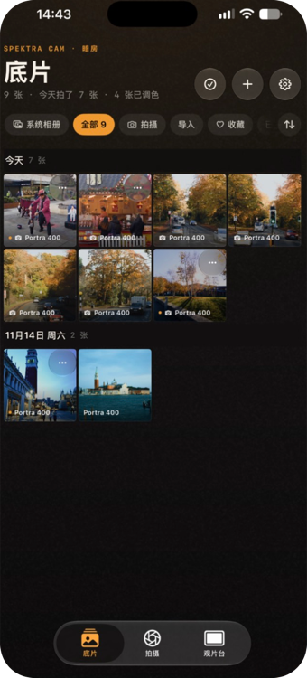
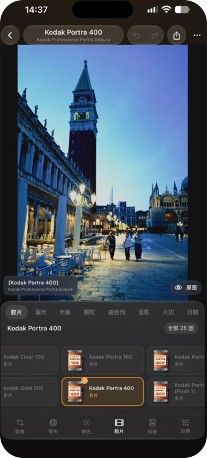
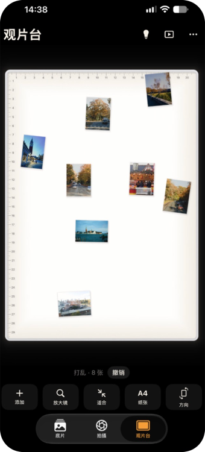
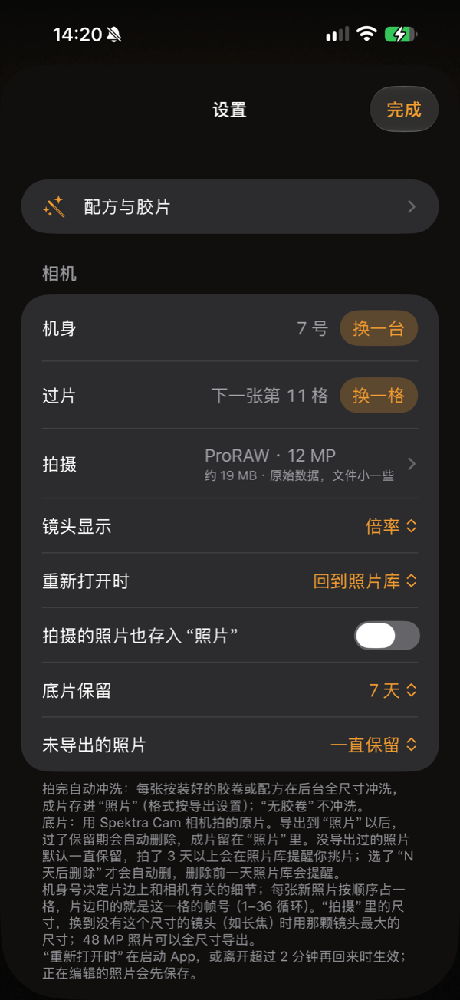

# Spektra Cam · SpektraLab 非官方 iOS 移植版

**Spektra Cam 是 [SpektraLab](https://github.com/JamesQiu2005/SpektraLab)（Mac 上的胶片冲洗软件）的非官方 iPhone 移植版。** 用的是同一个胶片物理引擎——胶片曝光、染料层、颗粒、光晕、放大机与相纸，一路算下来，而不是给照片套一张 LUT——并在 iPhone 上加了相机、观片台等功能。

> 非官方：不是 SpektraLab 作者发布的 App。
> 胶片引擎来自 [JamesQiu2005/SpektraLab](https://github.com/JamesQiu2005/SpektraLab)（本版用 2.4.1 引擎）；
> 起点是它的 iOS 社区移植版 [Minerchu/SpektraLab-iOS](https://github.com/Minerchu/SpektraLab-iOS) 1.2.0，之后界面重做、功能大幅扩展。

## 截图

| 底片 | 编辑 | 拍摄 |
|:---:|:---:|:---:|
|  |  |  |
| **观片台** | **设置** | **配方与胶片** |
|  |  |  |

截图在 iPhone 17 Pro Max 上用“iPhone 镜像”截取；拍摄页的取景画面在镜像时会被系统遮黑。

## 下载与安装

到 **[Releases](../../releases/latest)** 下载 `SpektraCam-2.1.1-unsigned.ipa`。IPA 没有签名，需要用自己的 Apple ID 重签：

| 工具 | 做法 |
|---|---|
| SideStore / AltStore / Sideloadly | 选这个 IPA，用自己的 Apple ID 签名安装 |
| Xcode | 按下面“本地构建”编译，在 Signing 里选自己的 Personal Team |

- 最低系统 **iOS 27.0**，只支持 iPhone。
- **目前只在 iPhone 17 Pro Max（iOS 27）上测试过。** 其他机型能装，但镜头焦段、拍摄尺寸、导出内存上限和 HDR 亮度没有验证过，可能有问题。
- 免费 Apple ID 的签名 7 天后过期，要重新安装。
- IPA 里带了全部引擎资源，第一次打开不需要联网下载。

## 2.1.1 的变化（相对 2.1.0）

**引擎升到 SpektraLab 2.4.1**
- 新胶片：Portra 160 NC / 160 VC / 400 NC / 400 VC（VC 默认配 Portra Endura 相纸）。
- 漏光加「边缘烧灼」，可以换随机位置或回到机身位置。
- 片边里多了「电影画幅」：Super 8、Super 16、35 mm 4 齿孔、65 mm 5 / 15 齿孔，以及 135 带齿孔全幅。
- 胶片和相纸按品牌排列。

**编辑**
- 裁剪页像「照片」一样：框不动，拖动、双指缩放照片；新增向左转 90° 和水平翻转。
- 色彩平衡改成四个色轮（全局、阴影、中间调、高光）。
- 新增**通道混合**和**水印**（PNG 标志或文字，放在四个角，可调大小、边距、透明度、旋转和颜色；导出、缩略图、观片台都会带上）。
- 编辑页 ⋯ 菜单可以打开直方图。

**拍摄与底片**
- 拍摄格式改成说明页：HEIF（日常推荐）、ProRAW（认真拍时用）、RAW（单帧，只适合光线充足）各写清楚用途和文件大小。
- 复制配方后，长按任意照片就能粘贴或清除；来源照片不再被锁住。

## 2.1.0 的变化（相对 2.0.0）

**拍摄**
- **相纸跟着胶卷走**：选好胶卷自动用它的推荐相纸（如 Portra 400 → Portra Endura，电影卷 → 2383），胶卷名下面的「相纸」按钮可以换；推荐相纸里选的那张会记住。编辑时选胶片也是同一套规则，拍出来和以后再冲洗颜色一致。
- **收藏组合**：胶卷名旁的 ☆ 一键把「胶卷 + 相纸」存成组合，排在胶卷栏最前面。
- **像原相机一样调曝光**：点一下对焦，在画面上下拖动调曝光（太阳滑块），长按锁定对焦与曝光（AE/AF 锁定）。
- 单帧 RAW 自动少曝光 1 档保住高光，冲洗时由胶片测光补回。
- 拍摄页里相机控制键和音量键都能当快门。
- 焦段按钮显示倍率（0.5 · 1× · 2 · 4 · 8），也可以切回焦段；横拿手机时按钮跟着转正；胶卷下方显示相纸。
- 「无胶卷」拍的照片只存进系统相册，不再进底片。

**导入与 RAW**
- **各家相机的 RAW**：系统读不了、只给出内嵌小预览或解出全黑的，自动改用 LibRaw 解码；没有拍摄白平衡的老机身（如 Mamiya ZD）用相机的日光白平衡。用 22 种格式的样张测过：Canon CR3 / CR2 / CRW、Nikon NEF（含 Z 8 高效压缩）、Sony ARW、Fujifilm RAF、Panasonic RW2、Olympus ORF、Pentax PEF、Leica DNG / RWL、Hasselblad 3FR、Phase One IIQ、Leaf MOS、Mamiya MEF、Samsung SRW、Kodak DCR、Minolta MRW、Epson ERF、DJI 与 iPhone DNG。
- **「照片」的分享菜单里有 Spektra Cam**：选照片分享过来，下次打开 App 时导入（RAW + JPEG 只留 RAW）。
- 导入的照片默认「无胶片」（原图），想冲洗时再选胶片。
- 「导入过」只看照片还在不在底片里：删掉后可以重新导入；全都导入过时可以选「再导入一次」。
- 导入失败会逐个列出文件和原因；RAW 的缩略图在导入结束后逐张生成。
- 设置里可以查看和修改相册权限（只给了部分照片时也能改）。

**编辑**
- **预览改为 Display P3**：编辑画面、缩略图、幻灯和导出的成片颜色一致（以前预览是 sRGB，比成片灰）。
- **无胶片**：胶片里的第一项，显示原图（RAW 用系统或 LibRaw 的默认解码），后期和裁剪照常可用。
- **反转片 HDR**：反转片用引擎的两次渲染算出每个像素的增益，编辑画面在 HDR 屏幕上更亮，导出 JPEG / HEIF 附增益图。

**底片**
- 选择时像系统相册一样**横向滑动连选**，拖到屏幕边缘自动滚动；全选 / 取消全选。
- 挑片成为单独的按钮；日期标题改成悬浮的小标签。

**观片台**
- 照片默认按底片实际尺寸摆放，也可以切到 5 寸相片尺寸；选中一张后双指单独缩放，一键回到原大小。
- 叠放的照片互相遮挡；底部「胶片托盘 · 关灯 · 放大镜」，从托盘点一下或拖到台上。
- 长按进入沉浸式大镜片（镜片避开手指，四周变暗）；放大时自动冲洗 2048 px 清晰版；幻灯可双指放大。

## 2.0.0：相对社区移植版 1.2.0 的变化

**界面：暗房**
- 新名字、新图标；全新配色（石墨黑、相纸白、安全灯琥珀色）、胶片颗粒背景。
- 底栏三处：**底片**（图库）· **拍摄** · **观片台**。

**底片（图库）**
- 一排点一下就切换的筛选（拍摄 / 导入 / 收藏 / 已调色 / RAW / 双拼 / 胶片），按拍摄时间、添加时间或胶片排序。
- 按天分组；像系统相册一样双指缩放，每行 1–14 张，缩远了按月分组。
- 直接读系统相册（不复制），或导入到 App 里；从“文件”、存储卡（读卡器，整个 DCIM 文件夹）、其他 App 导入，RAW + JPEG 只留 RAW，导入过的自动跳过。
- 挑片：没导出的拍摄按天列出，留下的导出、其余删除；底片保留期可设。
- 配方库：存配方、收藏胶片，一键套到多张照片。

**编辑**
- 按光路排的工具：取景 · 镜头 · 曝光 · 胶片 · 相纸 · 后期。
- 裁剪与拉直、全局撤销 / 重做、长按看原图。
- 解码曲线、黑白胶片（Tri-X、T-Max 100、Acros II、HP5，配 Multigrade 相纸 00–5 号）、去防光晕层、漏光、柔光镜、镜头风格（漩涡、Petzval、老镜头、玩具镜头）。
- 后期（Layer 2）：光线、色彩、HSL、曲线、色彩平衡。
- **HDR**：引擎按胶片与相纸的肩部算出每个像素的增益，编辑画面在 HDR 屏幕上亮过白色；导出 JPEG / HEIF 时附 ISO 增益图。
- 半格双拼：两张拼成一张半格胶片。
- 导出：JPEG / 10-bit HEIF / 16-bit TIFF / PNG，sRGB / Display P3 / Adobe RGB / ProPhoto，按内存自动限制尺寸，48 MP 可全尺寸导出。

**拍摄**
- ProRAW、单帧 RAW（不做多帧合成与降噪）、HEIF；按镜头列出真实尺寸。
- 焦段 13 / 24 / 48 / 100 / 200 mm（48 和 200 是传感器内裁切），双指变焦。
- 取景器实时显示胶片色彩（引擎烘出的 3D LUT）；手动快门、ISO、曝光补偿、色温；水平仪、网格、直方图。
- 胶卷可以是一种胶片、一个配方，或“无胶卷”（原始文件直接进“照片”）；拍完可自动在后台冲洗。

**观片台**
- 把照片按真实毫米尺寸摆在 A4 / A5 / A6 灯箱上，拖动、旋转、整理、打乱。
- EDR 背光、开关灯、放大镜（2–8×，按住不动凑近）、全屏幻灯。

工程、目标和内部代码仍沿用 `SpektraLab` 这个名字（`ios/SpektraLab.xcodeproj`），只有 App 显示为 Spektra Cam。

## 本地构建

需要 Apple silicon Mac、Xcode 27.2+、iOS 27 SDK、Python 3.10+。

```bash
git clone <本仓库地址>
cd SpektraLab-iOS-SpektraCam

# 引擎：上游 2.4.1
GITHUB_TOKEN="<你的 GitHub Token>" python3 tools/fetch-engine.py \
  JamesQiu2005/SpektraLab f61769b6779632497cb9c457945326c8de45436e .
# 2.4.x 去掉了胶片封面图：从上一个引擎版本取回 engine/resources_product/film_covers
GITHUB_TOKEN="<你的 GitHub Token>" python3 tools/fetch-engine.py \
  JamesQiu2005/SpektraLab 02d82b56cf65f0f8e802a708612edc4e9a4790af /tmp/engine-1.3.5
cp -R /tmp/engine-1.3.5/engine/resources_product/film_covers engine/resources_product/
python3 tools/apply-ios-patch.py engine      # 只能在刚取下的引擎上跑一次

bash engine/setup-libraw.sh                  # LibRaw 0.22.2
ios/Tools/build-engine.sh bundle device      # 必须在生成工程之前

SPEKTRAFILM_BUNDLE_ID=<你的 bundle id> SPEKTRAFILM_SIGNING_STYLE=Automatic \
SPEKTRAFILM_SIGN_IDENTITY="Apple Development" SPEKTRAFILM_TEAM_ID=<你的 Team ID> \
  python3 ios/Tools/gen-project.py
open ios/SpektraLab.xcodeproj
```

`ios/Tools/build-engine.sh bundle device` 要在 `gen-project.py` 之前运行，否则工程里没有 `engine-assets.bin`，App 会一直显示“引擎还在准备”。

想要“相机控制键启动”（锁屏时按相机控制键 → 解锁 → 进入拍摄页），生成工程时加 `SPEKTRAFILM_CAMERA_CONTROL=1`，会多编两个扩展；只能用 Xcode 自己签名安装。

免费账号也能用 `com.apple.developer.kernel.increased-memory-limit`（已写在 entitlements 里），48 MP 全尺寸导出需要它。

## 已知限制

- 只在 iPhone 17 Pro Max 上测试过（见“下载与安装”）。

- 只支持 iPhone；没有 iPad 布局。
- 没有视频。
- HDR 增益图最长 2048 px。
- 不支持 Sigma Foveon（X3F）和 GoPro GPR 两种 RAW（App 内的 LibRaw 读不了），导入时会提示。
- 从分享菜单传来的照片要等打开 App 时才导入（分享扩展不能直接打开 App）。
- 不能用相机控制键直接启动（需要一个锁屏扩展，而 SideStore 这类工具签不了它；代码保留，以后再上）。
- 用免费 Apple ID 重签会占 2 个 App ID（主程序 + 分享扩展），并用到 App Group。
- `.github/workflows/build-ios.yml` 是社区版原样保留的 CI：它固定在旧引擎、要用社区版的签名密钥，构建不了这个版本；fork 仓库默认不运行 Actions，请不要启用它。本版的 IPA 是在本地构建的。

## 许可与致谢

Spektra Cam 站在这些开源项目上：

| 项目 | 用在哪里 | 许可 |
|---|---|---|
| [SpektraLab](https://github.com/JamesQiu2005/SpektraLab)（JamesQiu2005） | 胶片冲洗引擎（C++ / Metal）、黑白胶片与 Multigrade 相纸描述档、观片台与 HDR 等部分代码 | GPL-3.0-or-later |
| [spektrafilm](https://github.com/andreavolpato/spektrafilm)（Andrea Volpato） | SpektraLab 引擎所依据的胶片过程模型；28 种胶片与相纸实测描述档、放大 LUT | 模型 GPL-3.0-or-later；描述档与 LUT CC BY-SA 4.0 |
| [SpektraLab-iOS](https://github.com/Minerchu/SpektraLab-iOS)（Minerchu） | 起点代码：iOS 社区移植版 1.2.0 | GPL-3.0-or-later |
| [LibRaw](https://github.com/LibRaw/LibRaw) 0.22.2 | Core Image 读不了的 RAW 的回退解码 | LGPL-2.1 / CDDL-1.0 |
| [metal-cpp](https://developer.apple.com/metal/cpp/)（Apple） | 引擎调用 Metal 的 C++ 接口 | Apache-2.0 |

Spektra Cam 的代码按 **GPL-3.0-or-later** 分发（见 `LICENSE`）；胶片与相纸描述档按 **CC BY-SA 4.0** 分发。

## 商标

SpektraLab™ 及其图标归其权利人所有。Spektra Cam 是独立的非官方项目，与 SpektraLab 官方、spektrafilm 项目都没有关联，也未获其认可；它有自己的名字和图标，只说明“基于 SpektraLab 引擎”。胶片、相纸的名称是各自厂商的商标，只用来说明描述档依据的是哪份公开数据。
